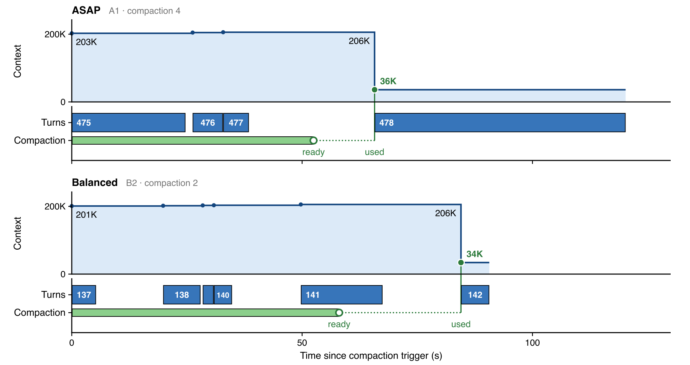
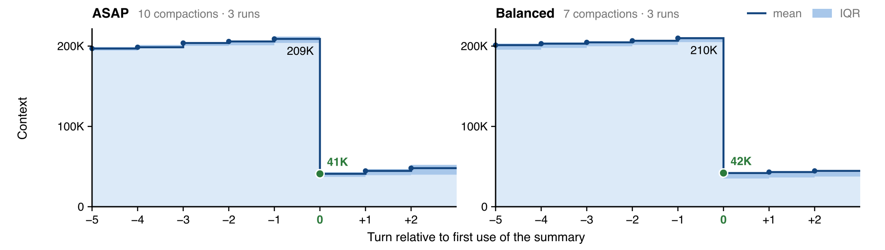

# Async, balanced compaction on Sail + Pi Durable

> Done properly, compaction should be cheap and near instant
>
> — [Jediah Katz on X](https://x.com/jediahkatz/status/2116307783075139912)

This makes sense, compaction should be instant because - if we are continously compacting, we don't need to wait for the context window filling up to compact.
We can simply kick off compaction **async, before** while generation is still happening.

Since this workflow is async, we can run it at balanced latency (= lower costs), ~for free<a name="compaction-note-ref"></a><sup>[[1]](#compaction-note)</sup>

This demo implements _async_ compaction (running during generation ie) on _Sail balanced_ inference: to get **20% cheaper compaction** without impacting performance.

<a name="compaction-note"></a>
<sub><a href="#footnote">[1]</a> for free here since if we are working at a lower <em>effective</em> context window of a model (ie << the total possible a API allows, eg 200 or 500k for a 1mn context model) we only compact when we chose to. We wait for the current turn generation / model response to complete and tools to run before changing the prompt with the summary (appending the uncompacted turns). See more below </sub>

## Evals

To test that the reduction in cost is indeed "free", we test on Terminal-Bench 4.1 -- a long running benchmark requiring frequent compactions, on a Sailbox naturally :)

(Due to token constraints 😅) We use six runs of the  `retro-console-soc` task, with 3 runs using ASAP inference for summaries and 3 runs using Balanced

For all runs, we use:

- DeepSeek V4.1 Flash 1017
- high reasoning
- ASAP inference for the main agent
- an artificial max token limit of 200k tokens, instead of the max supported 1mn
  - as result, we **disable** forced compaction
  - 200k is on the lower side for a token limit, but it helps us eval by triggering more compactions

### Results

Headline numbers:

> Sail Balanced costs **31.2% less** per compaction, with a **23.2% saving** at identical summary token usage

The cheaper compaction does not impact the overall performance (throughput):

| Measurement | ASAP | Balanced |
|---|---:|---:|
| Overall throughput | 104.16 tokens/s | 104.69 tokens/s |
| Context after compaction | 41.0K tokens | 41.9K tokens |
| Additional turns before compaction | 3.6 | 3.9 |

### Interpreting the results

Its not an intuitive result that slower compaction can be free, since most coding agents have compaction as a blocking action which takes infamously long. The trick here is that we don't wait for compaction to be blocking and instead let it run async, where the difference in latency only blocks generation with low probability.

For example, the figure below shows a compaction from one of the terminal bench runs. The compaction is "triggered" during run 475, which spawns a background task summarizing the conversation till that point. **At the same time**, the NEXT turns like 476, 477 are also being generated. This way, when the summarization is done - we simply append 476 and 477 turns to the context.



Thus - the delta in latency of ASAP and Balanced does not block agent time. Instead, the only difference is if any **additional** turns are run during compaction (since we do not compact / change prefix mid turn). For example, in the fig above balanced causes a wait for another turn. Emprically - this is minor, with balanced having on average 0.3 turns more waiting. As the figure shows below: token size before & after compaction, and # of compactions, is comparable for ASAP and Balanced.



### Reproduce

Reproduce results on Sailboxes

Inside a Sailbox, install Harbor, Sail and this repo's agent:

```bash
git clone https://github.com/Aditya-Mehta1/pi-async-compaction.git
cd pi-async-compaction
uv pip install --system harbor==0.25.0 sail==0.17.2
export SAIL_API_KEY=sk_your_key_here
export PYTHONPATH=packages/coding-agent/src/experimental/durable

git clone --depth 1 --branch v4.1.0 https://github.com/harbor-framework/terminal-bench.git
# This task uses Fedora; Sail runs its agent and verifier through Docker Compose.
cp packages/coding-agent/src/experimental/durable/harbor-compose.yaml terminal-bench/tasks/retro-console-soc/environment/docker-compose.yaml
cp packages/coding-agent/src/experimental/durable/harbor-compose.yaml terminal-bench/tasks/retro-console-soc/tests/docker-compose.yaml
```

Run w ASAP compaction (`normal`):

```bash
harbor run -p terminal-bench/tasks/retro-console-soc -a harbor_agent:PiDurable --ak mode=normal \
  --env sail.harbor:SailboxEnvironment -o jobs/asap
```

Run w Balanced compaction (`async`):

```bash
harbor run -p terminal-bench/tasks/retro-console-soc -a harbor_agent:PiDurable --ak mode=async \
  --env sail.harbor:SailboxEnvironment -o jobs/balanced
```

### Durable coding agent + Harbor connection

A headless coding agent on Pi Durable. 

- `main.ts`: arguments, event log, signals; open, run, close.
- `runtime.ts`: Pi services, model selection, Harness, and cleanup.
- `sessions.ts`: session directories and the process lock.
- `prompt.ts`: Pi's prompt with Durable's tool descriptions.
- `print.ts`: submission, committed events, timing, and usage after background work finishes.

`harbor_agent.py` runs Harbor tasks and reports usage, cost, and compaction metrics.
